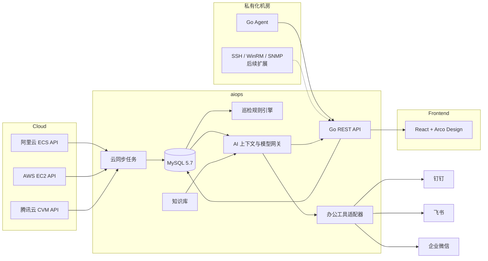

# 架构说明

## 1. 总体架构



## 2. 数据流

### 云资源

1. 定时任务读取启用状态的云账号。
2. 解密 AK/SK 或 STS 凭据。
3. 调用云厂商只读列表 API。
4. 以 `account_id + instance_id` 作为幂等键更新资源。
5. 本次未出现的资源标记为 `terminated`。
6. 记录同步运行结果与审计日志。

### 私有化主机

1. 管理端创建 Agent，返回一次性 Token。
2. 数据库仅保存 Token 的 SHA-256。
3. Agent 主动 POST 上报。
4. 服务端更新 Agent 心跳、资源快照和指标历史。
5. 巡检任务读取最新指标并执行阈值规则。
6. AI 服务读取最新巡检、资源、指标和知识库上下文。

## 3. 模型设计

核心资源表 `resources` 保持厂商无关：

- 身份：`source`, `source_id`, `external_id`
- 归属：`provider`, `account_id`, `region`, `zone`
- 主机：`name`, `status`, `private_ip`, `public_ip`, `os_name`
- 规格：`cpu_cores`, `memory_mb`, `disk_gb`
- 扩展：`tags_json`, `metadata_json`
- 生命周期：`last_seen_at`, `created_at`, `updated_at`

厂商字段保存在 `metadata_json`，避免每接一个云厂商就改主表。

## 4. 巡检与 AI 的边界

规则巡检负责确定性判断：

- CPU、内存、磁盘、I/O、网络、Load、Agent 离线。
- 输出结构化 findings 和健康分。

大模型负责解释和问答：

- 根据 CMDB、最新指标、巡检结果和知识库生成自然语言回答。
- 不直接执行命令。
- 模型失败时降级为本地规则回答。

当前智能处理边界是“生成受控操作单”，不是自由执行。已实现：

- 操作白名单
- 人工审批
- Agent 主动拉取任务
- 执行超时与输出限长
- 操作审计
- 高风险动作显式提示

后续仍需补充：

- 处置预案版本管理
- 更细粒度 RBAC
- 幂等重试与回滚
- 批量操作编排
- 云 API 变更操作

## 5. 办公工具 Agent

办公工具不单独维护一套业务逻辑，而是作为 aiops Agent 的通道：

```text
钉钉 / 飞书 / 企业微信消息
          ↓
平台签名校验、消息去重
          ↓
统一 ChatService.Ask()
          ↓
CMDB + 指标 + 巡检 + 知识库
          ↓
大模型 / 本地规则
          ↓
平台消息 API 回复
```

这样控制台、钉钉、飞书、企业微信得到的是同一份数据和同一套答案边界。

## 6. 安全设计

- 云凭据：AES-256-GCM 加密后落库。
- Agent Token：随机 256 bit，数据库仅存 SHA-256。
- 登录：HMAC-SHA256 JWT。
- 办公平台：
  - 飞书：verification token + 可选事件签名/AES 解密。
  - 企业微信：SHA-1 签名 + AES-CBC 解密 + CorpID 校验。
  - 钉钉：回调 URL Token + `sessionWebhook` 域名白名单。
- 模型上下文排除密码、云密钥、Agent Token。
- 删除云账号不删除历史资源，避免资产记录丢失。

## 7. 可扩展方向

1. 云监控 API 指标接入，覆盖没有 Agent 的云主机。
2. 资源关系与拓扑：主机、应用、数据库、负载均衡、依赖关系。
3. 向量知识库和工单自动复盘。
4. 告警中心、值班、通知、抑制和升级。
5. 自动处置 Playbook、审批策略和回滚。
6. RBAC、租户、资源权限和数据脱敏。
